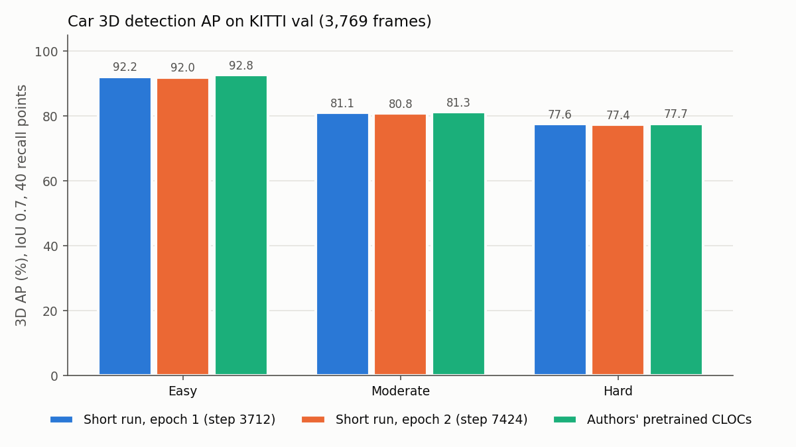
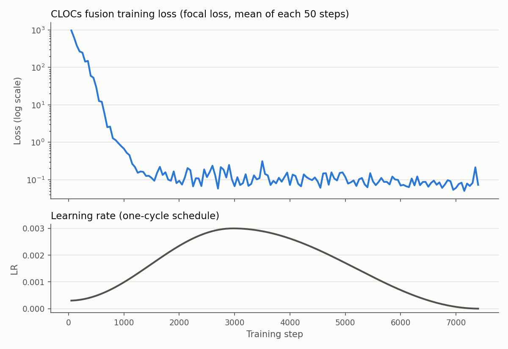
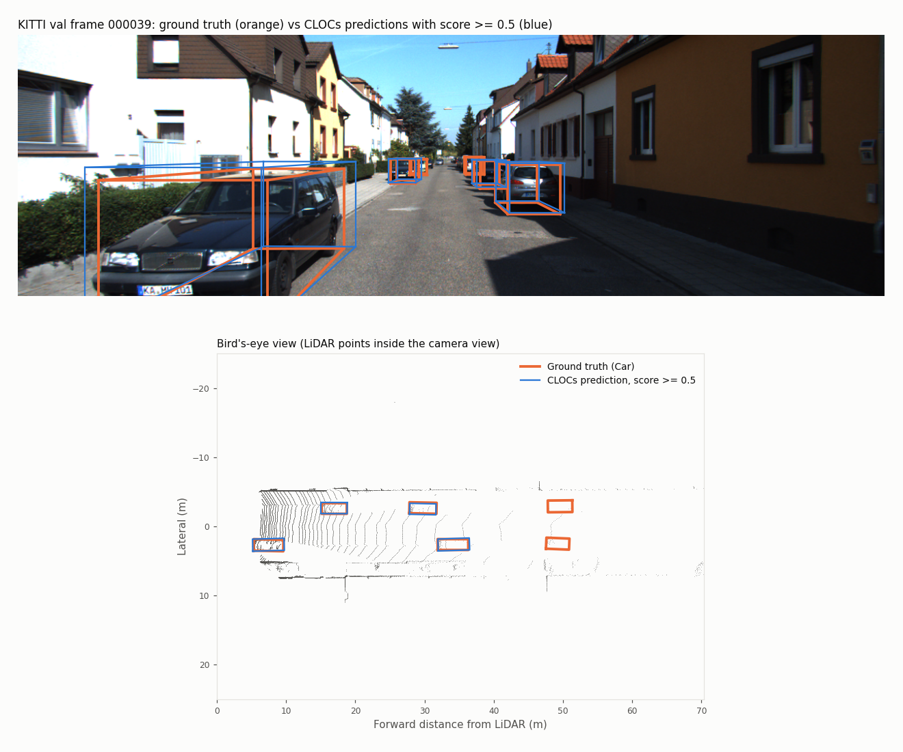
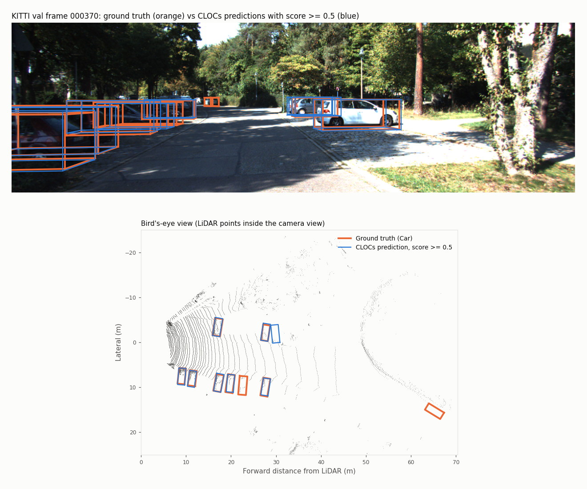

# CLOCs short training run: KITTI Car (SECOND + Cascade-RCNN)

A short (2-epoch) training run of the CLOCs fusion network, run on 2026-10-15 to confirm that training works on our setup and to see how quickly it approaches the authors' pretrained model.

## Summary

| | 3D AP Easy | 3D AP Moderate | 3D AP Hard |
|---|---|---|---|
| **This run, epoch 1** (step 3712) | 92.23 | **81.07** | 77.58 |
| **This run, epoch 2** (step 7424, final) | 92.01 | 80.82 | 77.42 |
| Authors' pretrained CLOCs (re-evaluated on this machine) | 92.75 | 81.28 | 77.70 |
| SECOND alone, no fusion (from the CLOCs README, not re-run here) | 90.97 | 79.94 | 77.09 |

Car, IoU 0.7, KITTI 40-recall-point AP, on the 3,769-frame validation split.

- After **one epoch (about 5 minutes of training)** the fusion layer is within 0.5 AP of the authors' fully trained model, and about 1.1 AP above SECOND alone on Moderate.
- The second epoch did **not** improve results. AP dropped by about 0.2 and validation loss rose from 0.134 to 0.151, which suggests the fusion layer is already close to converged after one epoch. This is a single run with one random seed, so differences of a few tenths of a point are within run-to-run noise.

## Setup

| | |
|---|---|
| Hardware | Jetstream2 VM, NVIDIA A100 vGPU slice (20 GB), 16 vCPUs |
| Software | Python 3.8, PyTorch 1.10.2 + CUDA 11.3, spconv 1.2.1 (see [`env.sh`](../env.sh)) |
| 3D detector | SECOND, authors' pretrained weights (`model_dir/voxelnet-30950.tckpt`), **frozen** |
| 2D detector | Cascade-RCNN detections provided by the CLOCs authors (`d2_detection_data/`) |
| Trained | CLOCs fusion layer only (17,747 parameters), trained from scratch |
| Data | KITTI object detection: 3,712 train / 3,769 val frames (standard split) |
| Config | [`second/configs/car.fhd.short.config`](../second/configs/car.fhd.short.config): same as `car.fhd.config` except `steps: 7424` (2 epochs, versus 37,120 = 10 epochs in the original) |
| Optimizer | Adam, one-cycle LR schedule (max 3e-3), weight decay 0.01, batch size 1, seed 3 |
| Wall-clock time | about 21 min total: about 5 min per training epoch (about 12 steps/s) plus about 5 min per full validation pass |
| Peak GPU memory | about 3.7 GB |

Command (from `second/`, after `source ../env.sh`):

```bash
python ./pytorch/train.py train --config_path=./configs/car.fhd.short.config --model_dir=../training_runs/car_short_2epoch
```

## Metrics

All four KITTI metrics, Car @ IoU 0.7 (Easy / Moderate / Hard). Also in [`metrics.csv`](metrics.csv).

| Model | Metric | Easy | Moderate | Hard |
|---|---|---|---|---|
| This run, epoch 1 | 2D bbox | 99.20 | 93.69 | 92.81 |
| This run, epoch 1 | BEV | 96.22 | 92.11 | 89.31 |
| This run, epoch 1 | 3D | 92.23 | 81.07 | 77.58 |
| This run, epoch 1 | AOS | 99.04 | 93.18 | 92.00 |
| This run, epoch 2 | 2D bbox | 99.09 | 93.58 | 92.67 |
| This run, epoch 2 | BEV | 96.13 | 91.96 | 89.12 |
| This run, epoch 2 | 3D | 92.01 | 80.82 | 77.42 |
| This run, epoch 2 | AOS | 98.92 | 93.07 | 91.87 |
| Authors' pretrained | 2D bbox | 99.33 | 93.74 | 92.87 |
| Authors' pretrained | BEV | 96.54 | 92.38 | 89.42 |
| Authors' pretrained | 3D | 92.75 | 81.28 | 77.70 |
| Authors' pretrained | AOS | 99.17 | 93.27 | 92.08 |

Validation loss (fusion focal loss on the val split): 0.134 after epoch 1, 0.151 after epoch 2.



## Training curve

The fusion loss falls from about 1,000 to about 0.1 within the first 1,300 steps, then stays flat for the rest of training. Raw values are in [`loss.csv`](loss.csv).



## Output samples

Detections from the final model (epoch 2) on validation frames that have both near and far cars. In each figure, the top panel is the camera image with 3D boxes projected into it and the bottom panel is a bird's-eye view of the LiDAR points. **Orange = ground truth, blue = CLOCs prediction with score ≥ 0.5.** The matching text files in [`samples/`](samples/) list every box's score, position and size.

**Frame 000039:** every car within about 36 m is detected; the two cars at about 50 m are missed. This is the long-range weakness that motivates adding radar.


**Frame 000370:** a row of parked cars. 7 of 9 are found; one parked car at about 22 m and the far car at about 65 m are missed, and there is one extra box next to the car at about 28 m (a false positive).


More: [152](figures/sample_000152.png) · [186](figures/sample_000186.png) · [345](figures/sample_000345.png) · [408](figures/sample_000408.png) · [455](figures/sample_000455.png) · [548](figures/sample_000548.png)

## Logs and files

| File | Contents |
|---|---|
| [`logs/train_log.txt`](logs/train_log.txt) | the run's own log: full config, loss every 50 steps, validation results after each epoch |
| [`logs/train_console_clean.txt`](logs/train_console_clean.txt) | terminal output, with library warnings and progress bars removed |
| [`checkpoint/fusion_layer-7424.tckpt`](checkpoint/) | final trained fusion layer weights (76 KB) |
| [`metrics.csv`](metrics.csv), [`loss.csv`](loss.csv) | numbers behind the tables and plots |
| [`make_report.py`](make_report.py) | regenerates everything in this folder from a training run |

To evaluate the saved checkpoint: `python ./pytorch/train.py evaluate --config_path=./configs/car.fhd.config --model_dir=../results/checkpoint --batch_size=1`

To rebuild this report for another run: `python results/make_report.py --run_dir training_runs/<run_name>` (from the repo root). The sample images need the 8 KITTI camera images listed in `make_report.py`, saved in `KITTI_DATASET_ROOT/training/image_2/`.

## Notes

- **Code fix needed for training:** `train.py` ran SECOND's forward pass with gradients enabled even though SECOND is frozen, which used up the 20 GB GPU within 50 steps. It is now wrapped in `torch.no_grad()`. Only the fusion layer is in the optimizer, so this doesn't change what is trained.
- The authors' pretrained numbers here are from re-running their checkpoint on this machine. Its 3D Moderate AP (81.28) is 1.6 below the CLOCs README (82.90); the other numbers match to within 0.05. A likely cause is the newer spconv version (1.2.1 instead of 1.0), but this has not been confirmed.
- Only the Car class was trained. Pedestrian and Cyclist need separate SECOND models and code edits (see the main README).
