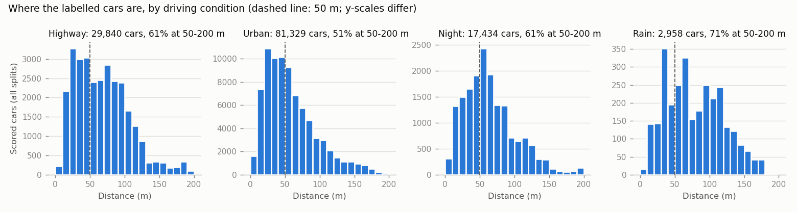
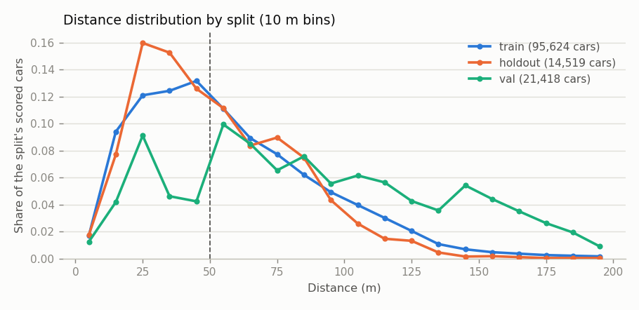
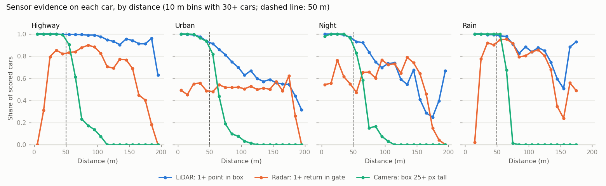

# The aiMotive dataset as used in this study

This page describes the data behind the full-dataset results: what is in it, where the vehicles are (especially beyond 50 m), and how much each sensor sees of them. The numbers come from `dataset_stats.py`, which measures every labelled object of every frame. Its complete tables are in [dataset_tables.md](dataset_tables.md) and the raw measurements in [dataset_stats.json](dataset_stats.json). How the study was run is in [METHODS.md](METHODS.md), and its results in [README.md](README.md).

```bash
source env.sh
python results/full_dataset/dataset_stats.py            # about 5 minutes; --report rebuilds tables and figures only
```

## What the study uses

- **Source:** the aiMotive multimodal dataset (CC BY-NC-SA 4.0). It has 176 scenes of 15 s each, with about 150 annotated frames per scene.
- **Sensors kept** by `clocs_r/fetch_aimotive.py`:
  - **Camera:** the front mid/long-range camera (`F_MIDLONGRANGECAM_CL`, 1280x704).
  - **LiDAR:** the points inside that camera's view.
  - **Radar:** the front long-range radar (`F_LRR_C`), all targets, every sweep. Each return has a position and an ego-compensated Doppler speed.
- **What is scored:** CAR, VAN and PICKUP labels whose box center is 0–204.8 m ahead, within 25.6 m sideways, and projects into the camera image.
  - **Ignored:** trucks, buses and trailers. A detection on one counts neither as a hit nor as a false alarm.
  - **Unused:** the other classes (pedestrians, bikes and so on).
  - **Occlusion and truncation:** both fields are 0 on every label, so neither can be used.
- **Distance:** "beyond 50 m" means 50–200 m, as in the evaluation.

| Split | Highway | Urban | Night | Rain | All (scenes / frames) |
|---|---|---|---|---|---|
| train | 63 / 8,924 | 46 / 6,525 | 22 / 3,117 | 3 / 428 | 134 / 18,994 |
| holdout | 7 / 990 | 6 / 851 | 3 / 425 | 1 / 142 | 17 / 2,408 |
| val | 12 / 2,252 | 9 / 2,040 | 2 / 444 | 2 / 445 | 25 / 5,181 |
| **all** | 82 / 12,166 | 61 / 9,416 | 27 / 3,986 | 6 / 1,015 | 176 / 26,583 |

Holdout is every 10th training scene within each condition. Val is aiMotive's own validation set.

## How many vehicles are beyond 50 m



Across the whole dataset, 72,082 of the 131,561 scored cars (55%) are 50–200 m away. 88% of frames contain at least one of them.

| Condition | Scored cars | 0–30 m | 30–50 m | 50–100 m | 100–200 m | Beyond 50 m | Share beyond 50 m |
|---|---|---|---|---|---|---|---|
| Highway | 29,840 | 5,663 | 6,034 | 12,522 | 5,577 | 18,099 | 61% |
| Urban | 81,329 | 19,886 | 20,225 | 29,707 | 11,447 | 41,154 | 51% |
| Night | 17,434 | 3,131 | 3,566 | 7,753 | 2,966 | 10,719 | 61% |
| Rain | 2,958 | 300 | 548 | 1,159 | 951 | 2,110 | 71% |
| **All** | 131,561 | 28,980 | 30,373 | 51,141 | 20,941 | 72,082 | 55% |

- **Urban scenes dominate.** They hold 62% of all scored cars and 57% of the far ones, so overall scores mostly reflect urban driving.
- **Rain is rare.** It has only 6 scenes and 2,110 far cars in the whole dataset. Training sees 772 far rain cars, against 8,643 at night and 25,687 in urban scenes.
- **Highway scenes have few cars per frame** (1.5 far cars, against 4.4 in urban frames), but those cars sit further out.

### The splits differ in distance



| Split | Scored cars | Beyond 50 m | 100–200 m | Far cars per frame |
|---|---|---|---|---|
| train | 95,624 | 48,925 (51%) | 11,779 (12%) | 2.6 |
| holdout | 14,519 | 6,785 (47%) | 938 (6%) | 2.8 |
| val | 21,418 | 16,372 (76%) | 8,224 (38%) | 3.2 |

This is the most important property of the data for the study.

- **Val is far-heavy.** 38% of val cars are 100–200 m away, against 12% of train cars and 6% of holdout cars. So val scores beyond 50 m depend much more on the hardest range than training or selection did.
- **Urban val is the extreme case:** 78% of its cars are far, against 45% in urban train scenes.
- **Holdout says little about the far adverse cases:**
  - **Rain:** its one rain scene has 142 cars, all at 30–50 m, and none beyond 50 m.
  - **Night:** it has only 13 cars at 100–200 m.
  - **Consequence:** the selection on holdout could not reward a model for far rain or far night performance. The rain and night results in [README.md](README.md) are therefore out-of-sample, and they rest on val's 2 night and 2 rain scenes alone.

| Val, by condition | Beyond 50 m | 100–200 m |
|---|---|---|
| Highway | 2,333 | 1,680 |
| Urban | 11,352 | 5,097 |
| Night | 1,349 | 719 |
| Rain | 1,338 | 728 |

## What each sensor sees of a far car



For each scored car, `dataset_stats.py` measures three things:
- the LiDAR points inside its 3D box;
- the radar returns inside the gate CLOCs-R uses (the box enlarged by 0.5 m + 0.02 × range, 3 sweeps);
- the height of its projected box in the native camera image.

| Beyond 50 m | Highway | Urban | Night | Rain | All |
|---|---|---|---|---|---|
| LiDAR: any point in the box | 98% | 77% | 80% | 87% | 83% |
| LiDAR: median points | 27 | 10 | 14 | 15 | 15 |
| Radar: any return in the gate | 81% | 51% | 61% | 81% | 61% |
| Radar: moving (Doppler > 1 m/s), of those with a return | 89% | 60% | 64% | 94% | 72% |
| Camera: median box height | 20 px | 20 px | 21 px | 15 px | 20 px |
| Camera: box under 25 px | 71% | 68% | 65% | 78% | 68% |
| Radar but no LiDAR | 0.8% | 7.4% | 9.9% | 6.2% | 6.1% |
| Neither LiDAR nor radar | 1.3% | 15.8% | 10.2% | 6.9% | 11.1% |

At 100–200 m (all conditions):
- 71% of cars have any LiDAR point, and only 48% have 5 or more.
- 58% have a radar return.
- 98% are under 25 px tall in the image, with a median of 13 px.

What this means for the models:

- **The camera barely sees far cars.** Beyond about 70 m, almost every car is under 25 px tall in the native image, and it stays small even after the 1.5x upscaling used for Cascade R-CNN. This is why Cascade R-CNN finds only 21% of cars at 100–200 m, and why CLOCs, which trusts camera agreement, falls behind SECOND alone at long range.
- **LiDAR thins out in urban and night scenes.** Highway cars beyond 50 m nearly all have LiDAR points (98%), but only 77% of urban and 80% of night cars do. In urban scenes, cars far ahead are likely hidden behind nearer traffic and roadside objects.
- **Radar is most informative where traffic moves:**
  - **Highway and rain:** 81% of far cars have a return in the gate, and about 90% of those returns show clear motion. Doppler speed therefore separates real cars from clutter well.
  - **Urban and night:** only 51–61% of far cars have a return, and only 60–64% of those are moving, because of parked and queued cars at low ego speed.
  - **This matches the results:** with the final CLOCs-R (R2+T2, 6 seeds), radar gain beyond 50 m is largest in rain (+0.052) and on highways (+0.016), and near zero in urban scenes (+0.002). See [`ablation/README.md`](ablation/README.md).
- **Rain scenes are fast, open-road drives.** The median ego speed is 112 km/h in rain, 94 km/h on highways, 51 km/h at night and 38 km/h in urban scenes. So the rain advantage mixes two things: radar's robustness to rain, and highway-like moving traffic, where Doppler helps anyway. With 2 rain scenes in val, the data cannot separate the two.
- **Radar cannot add cars SECOND never proposes.** CLOCs-R only rescores SECOND's candidates. Beyond 50 m, 6% of cars have radar returns but no LiDAR point, and SECOND, which works from LiDAR alone, has nothing to propose them from. Another 11% have neither LiDAR nor radar evidence, so no LiDAR-based pipeline can find them.
- **The radar barely covers close range on highways and in rain.** At 0–20 m, few cars there have a return (see the figure). The likely cause is the long-range radar's narrow beam close to the vehicle. This does not affect the far-range study.

## Other properties to keep in mind

- **Class mix.** CAR is 97% of the scored labels (127,005 of 131,561). Beyond 50 m in the evaluation region there are also 8,012 trucks, 1,336 buses and 219 trailers. These are ignored, so detections on them neither help nor hurt.
- **Scene correlation.** Frames within a 15 s scene are highly correlated. The effective sample size for the adverse conditions in val is therefore 2 scenes each, not about 450 frames. The per-scene table in [README.md](README.md) shows this directly.
- **Label differences between train and val.** aiMotive's train and val labels differ in box fitting, which caps strict 3D overlap metrics (see [`../detectors/README.md`](../detectors/README.md)). For this reason the study ranks models by center-distance AP and BEV AP@0.3 rather than AP3D.
- **Per-frame sensor load** is similar across conditions: a median of about 21,000 LiDAR points in the camera view, and 74–125 radar returns over 3 sweeps.
