# Example frames: where the models succeed and fail

Val frames picked automatically by `examples.py`, comparing SECOND alone, CLOCs (R0+T2, no radar) and CLOCs-R (R2+T2), seed 1. Each model runs at one fixed score threshold, the one that maximizes F1 on holdout: SECOND 0.207 (F1 0.714), CLOCs 0.153 (F1 0.700), CLOCs-R 0.153 (F1 0.712). A detection counts when it lies within 2 m of a labelled car's center. Within a category, frames come from different scenes, and the clearest cases come first (for example the largest score margin). They illustrate typical mechanisms and are not a random sample.

Camera images, LiDAR and radar data and labels in these figures are from the aiMotive multimodal dataset, used under CC BY-NC-SA 4.0. The figures are shared under the same license.

In each figure:

- **Top:** the camera image. The dashed boxes are labelled cars and the dotted white boxes are Cascade R-CNN's 2D detections. Colored boxes are each model's detections above its threshold (blue SECOND, orange CLOCs, green CLOCs-R).
- **Middle left:** a zoom on the yellow frame.
- **Middle right:** a bird's-eye view around the object, with LiDAR points (gray) and radar returns from the last 3 sweeps (violet triangles).
- **Bottom:** the whole scene from above, out to 205 m.

## Success: radar recovers a far car

A car beyond 50 m with at least one radar return in its gate that CLOCs-R detects and CLOCs, the same fusion without radar, misses (no CLOCs detection above its threshold within 4 m).

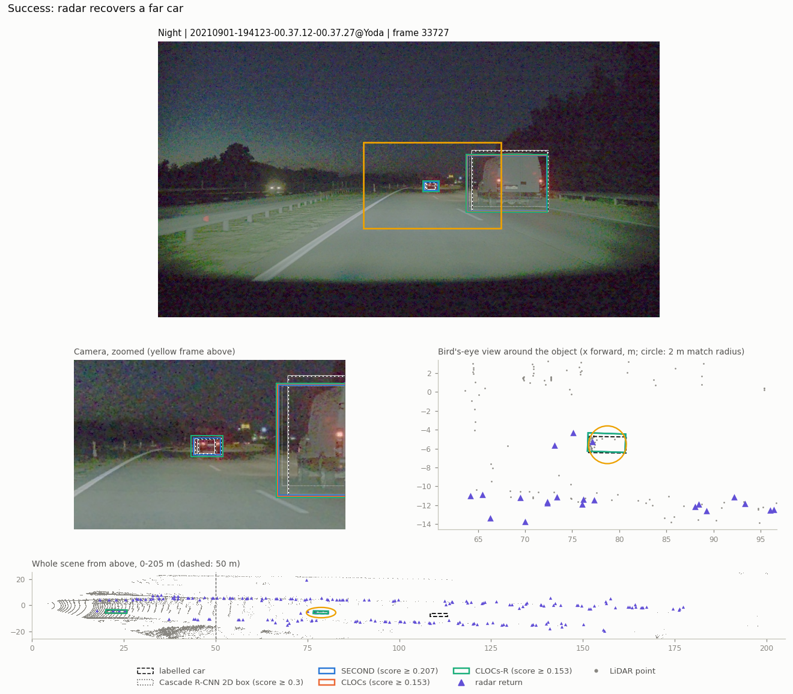

**Night**, scene `20210901-194123-00.37.12-00.37.27@Yoda`, frame 33727: car at 79 m. Best score within 2 m: SECOND 0.600 (above 0.207); CLOCs 0.107 (below 0.153); CLOCs-R 0.154 (above 0.153). 37 LiDAR points in the box, 2 radar returns in the gate (median Doppler speed 31.2 m/s).

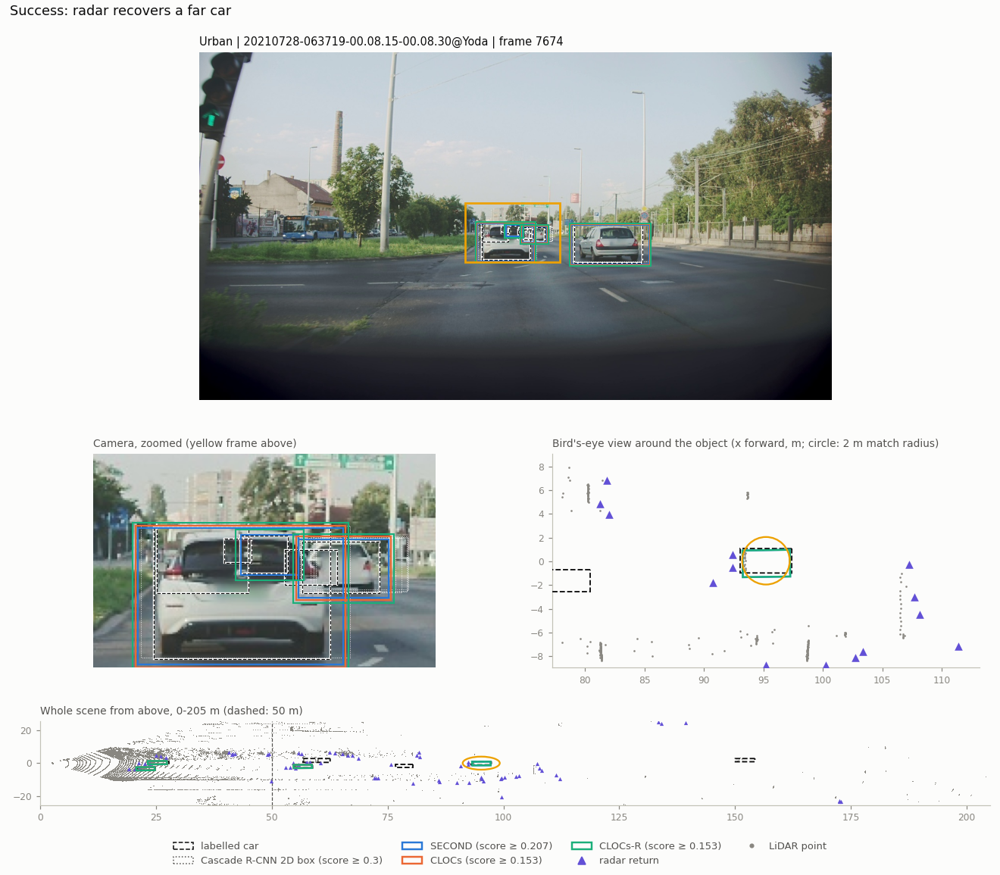

**Urban**, scene `20210728-063719-00.08.15-00.08.30@Yoda`, frame 7674: car at 95 m. Best score within 2 m: SECOND 0.424 (above 0.207); CLOCs 0.119 (below 0.153); CLOCs-R 0.154 (above 0.153). 16 LiDAR points in the box, 3 radar returns in the gate (median Doppler speed 16.0 m/s).

## Success: radar removes a far false alarm

A detection beyond 50 m with no car within 2 m that CLOCs keeps and CLOCs-R drops (no CLOCs-R detection within 4 m).

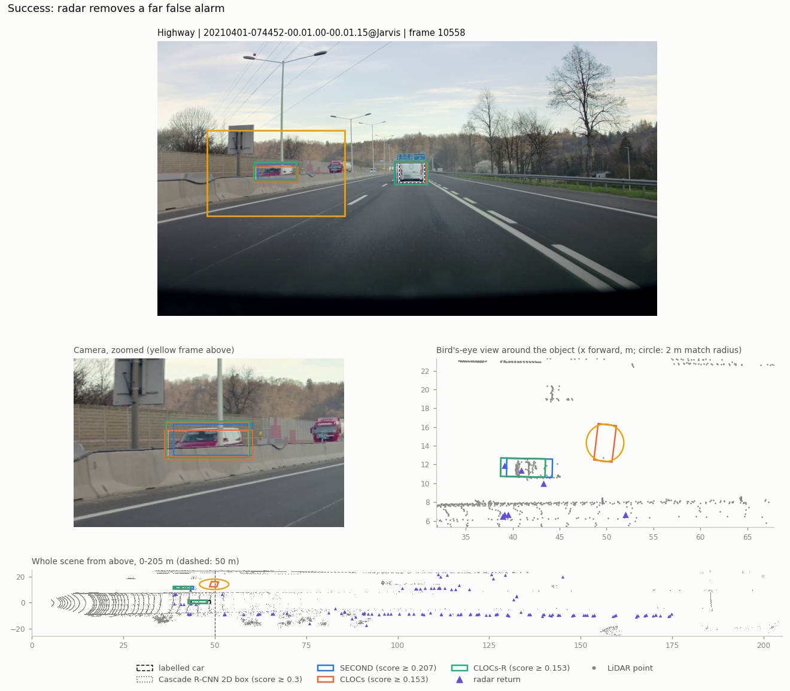

**Highway**, scene `20210401-074452-00.01.00-00.01.15@Jarvis`, frame 10558: false alarm at 52 m. Best score within 2 m: SECOND 0.014 (below 0.207); CLOCs 0.239 (above 0.153); CLOCs-R 0.112 (below 0.153). 

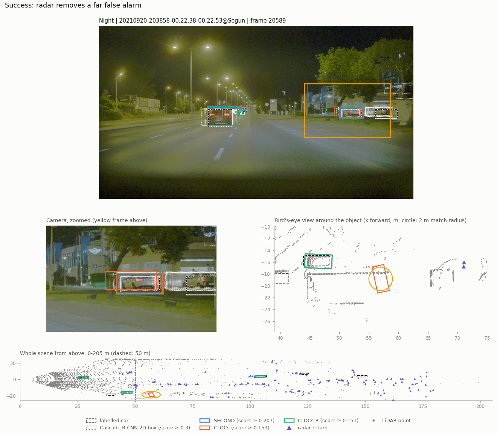

**Night**, scene `20210920-203858-00.22.38-00.22.53@Sogun`, frame 20589: false alarm at 60 m. Best score within 2 m: SECOND 0.064 (below 0.207); CLOCs 0.223 (above 0.153); CLOCs-R 0.145 (below 0.153). 

## Success: fusion recovers a car SECOND misses

A car that both fusion models detect and SECOND alone misses (no SECOND detection within 4 m).

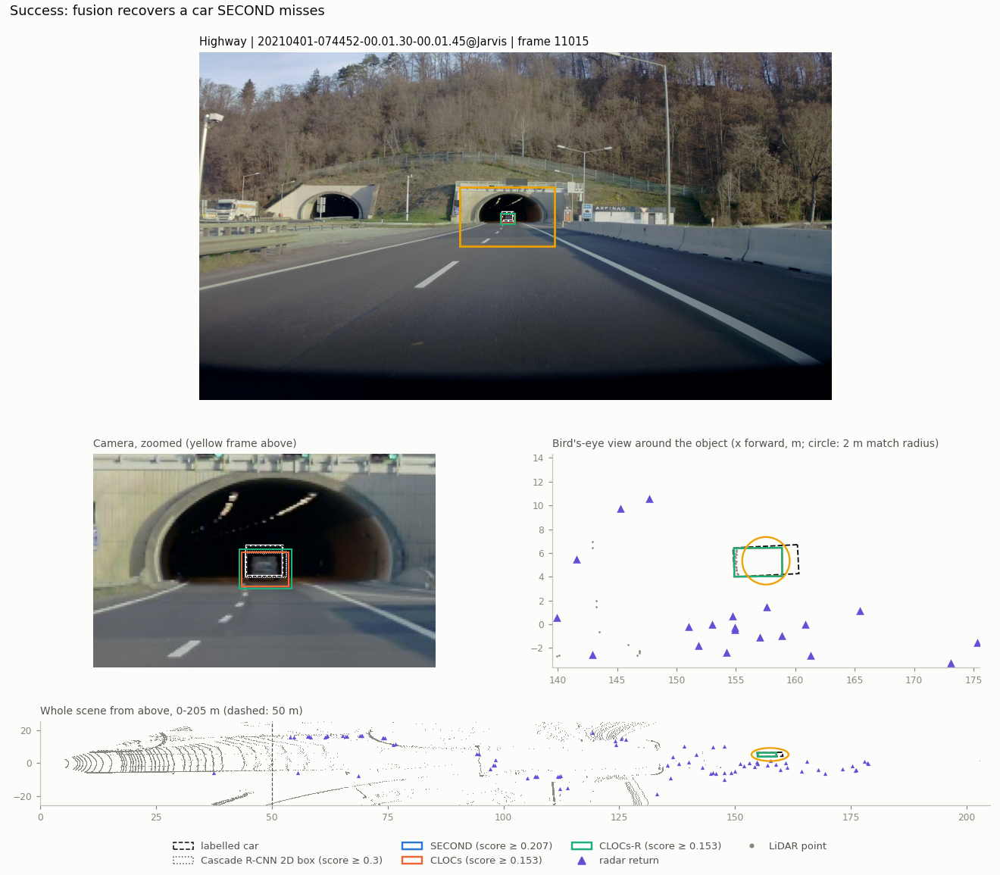

**Highway**, scene `20210401-074452-00.01.30-00.01.45@Jarvis`, frame 11015: car at 158 m. Best score within 2 m: SECOND 0.093 (below 0.207); CLOCs 0.236 (above 0.153); CLOCs-R 0.234 (above 0.153). 12 LiDAR points in the box, 2 radar returns in the gate (median Doppler speed 0.0 m/s).

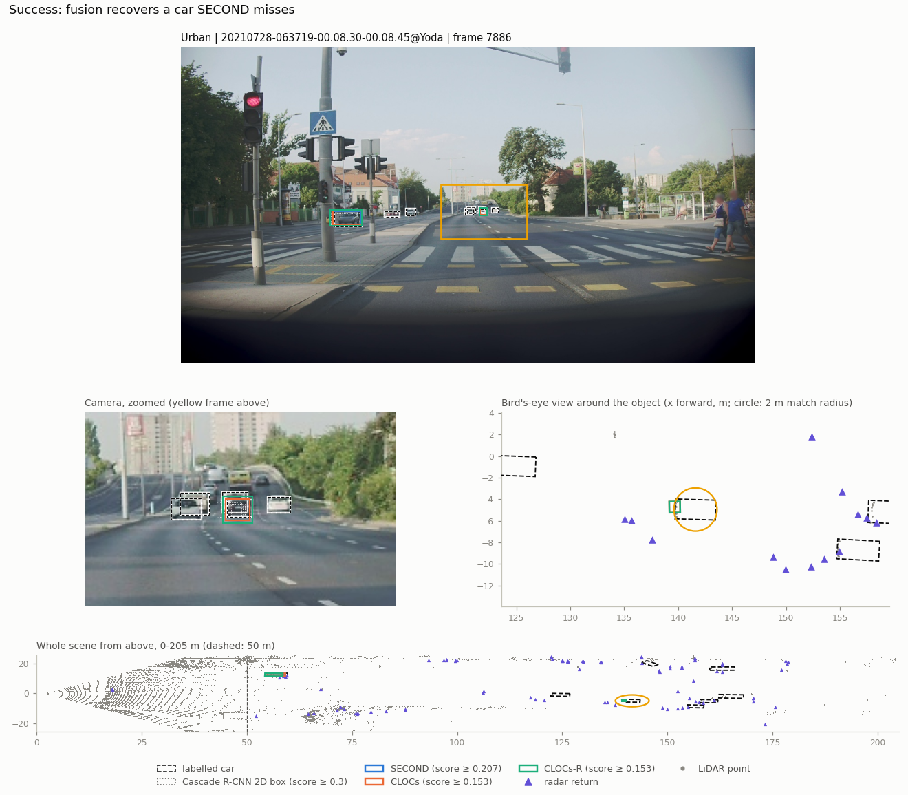

**Urban**, scene `20210728-063719-00.08.30-00.08.45@Yoda`, frame 7886: car at 142 m. Best score within 2 m: SECOND 0.137 (below 0.207); CLOCs 0.239 (above 0.153); CLOCs-R 0.221 (above 0.153). 9 LiDAR points in the box, 1 radar return in the gate (median Doppler speed 17.2 m/s).

## Failure: fusion drops a far car SECOND found

A car beyond 50 m that SECOND detects and neither fusion model does (no fusion detection above threshold within 4 m).

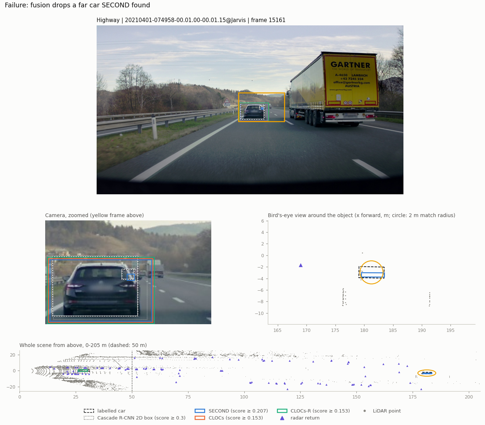

**Highway**, scene `20210401-074958-00.01.00-00.01.15@Jarvis`, frame 15161: car at 181 m. Best score within 2 m: SECOND 0.224 (above 0.207); CLOCs 0.110 (below 0.153); CLOCs-R 0.080 (below 0.153). 4 LiDAR points in the box, 0 radar returns in the gate.

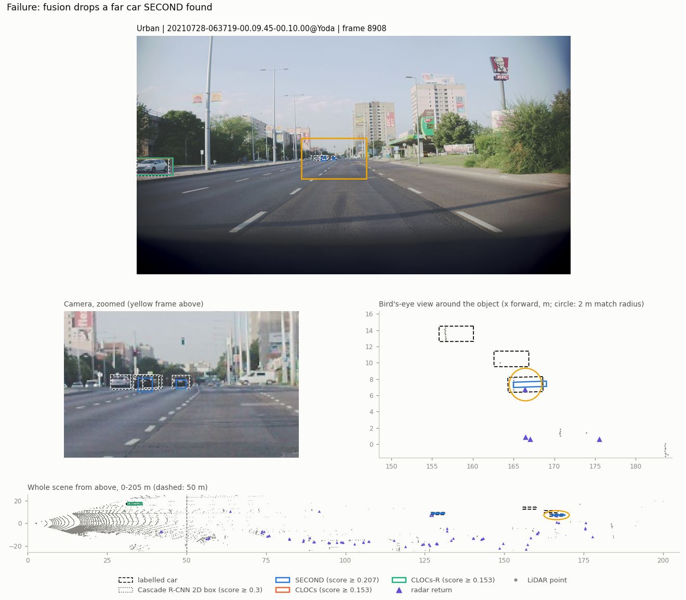

**Urban**, scene `20210728-063719-00.09.45-00.10.00@Yoda`, frame 8908: car at 167 m. Best score within 2 m: SECOND 0.246 (above 0.207); CLOCs 0.006 (below 0.153); CLOCs-R 0.033 (below 0.153). 7 LiDAR points in the box, 1 radar return in the gate (median Doppler speed 0.1 m/s).

## Failure: a far car no model finds

A car beyond 50 m that no model detects (nothing above threshold within 4 m). The caption gives its LiDAR and radar evidence.

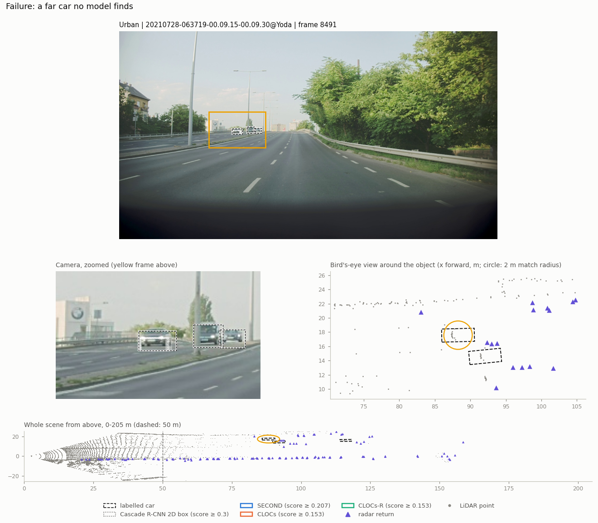

**Urban**, scene `20210728-063719-00.09.15-00.09.30@Yoda`, frame 8491: car at 90 m. Best score within 2 m: SECOND none within 2 m; CLOCs none within 2 m; CLOCs-R none within 2 m. 12 LiDAR points in the box, 1 radar return in the gate (median Doppler speed 19.6 m/s).

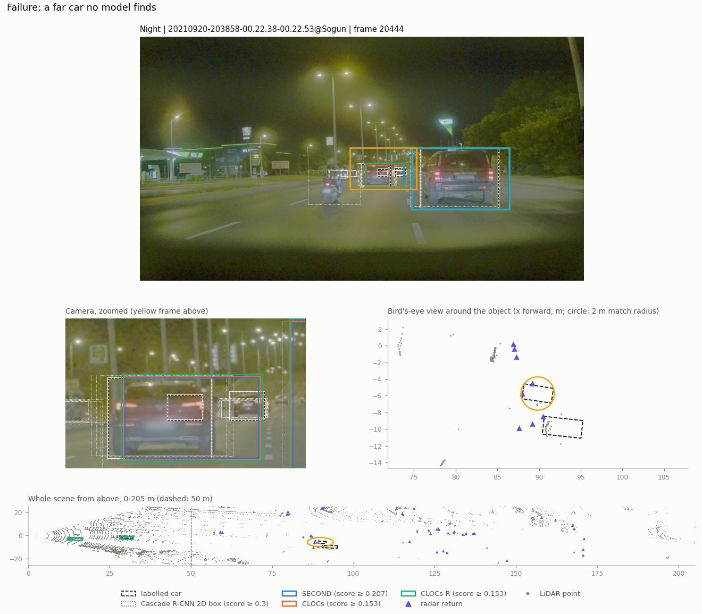

**Night**, scene `20210920-203858-00.22.38-00.22.53@Sogun`, frame 20444: car at 90 m. Best score within 2 m: SECOND 0.019 (below 0.207); CLOCs 0.011 (below 0.153); CLOCs-R 0.008 (below 0.153). 0 LiDAR points in the box, 3 radar returns in the gate (median Doppler speed 21.4 m/s).

## Failure: radar adds a far false alarm

A detection beyond 50 m with no car within 2 m and at least one radar return in its gate that CLOCs-R keeps and CLOCs does not (no CLOCs detection within 4 m).

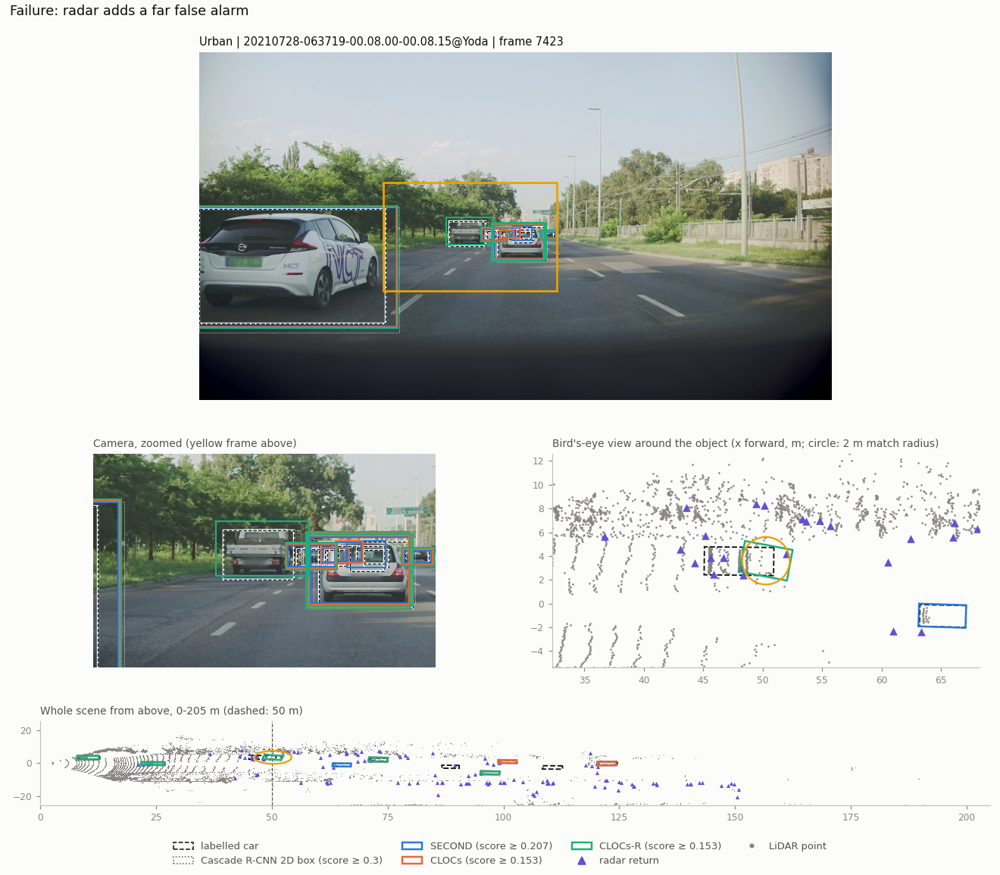

**Urban**, scene `20210728-063719-00.08.00-00.08.15@Yoda`, frame 7423: false alarm at 50 m. Best score within 2 m: SECOND 0.056 (below 0.207); CLOCs 0.148 (below 0.153); CLOCs-R 0.277 (above 0.153). 

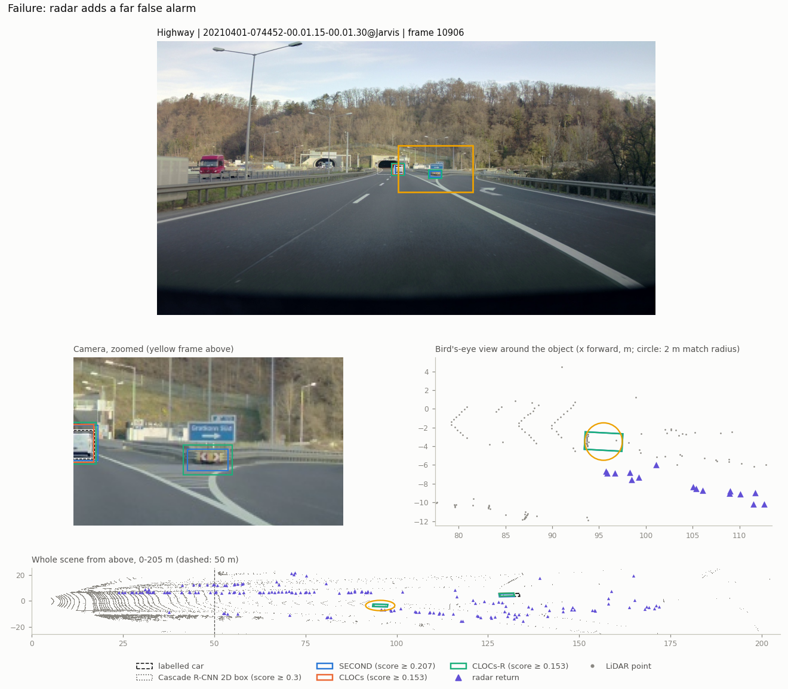

**Highway**, scene `20210401-074452-00.01.15-00.01.30@Jarvis`, frame 10906: false alarm at 96 m. Best score within 2 m: SECOND 0.624 (above 0.207); CLOCs 0.143 (below 0.153); CLOCs-R 0.245 (above 0.153). 

## Failure: a car missed at night or in rain

A car within 100 m in a night or rain scene that CLOCs-R misses (nothing above threshold within 4 m).

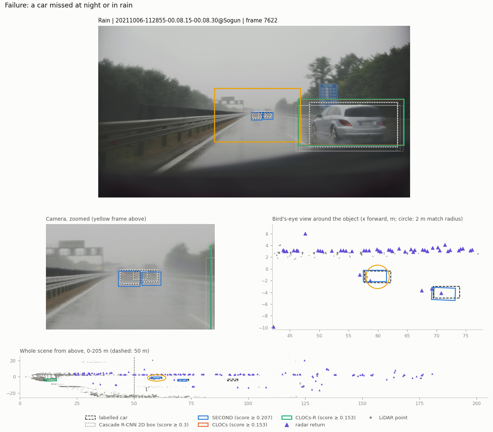

**Rain**, scene `20211006-112855-00.08.15-00.08.30@Sogun`, frame 7622: car at 60 m. Best score within 2 m: SECOND 0.467 (above 0.207); CLOCs 0.141 (below 0.153); CLOCs-R 0.140 (below 0.153). 49 LiDAR points in the box, 2 radar returns in the gate (median Doppler speed 25.9 m/s).

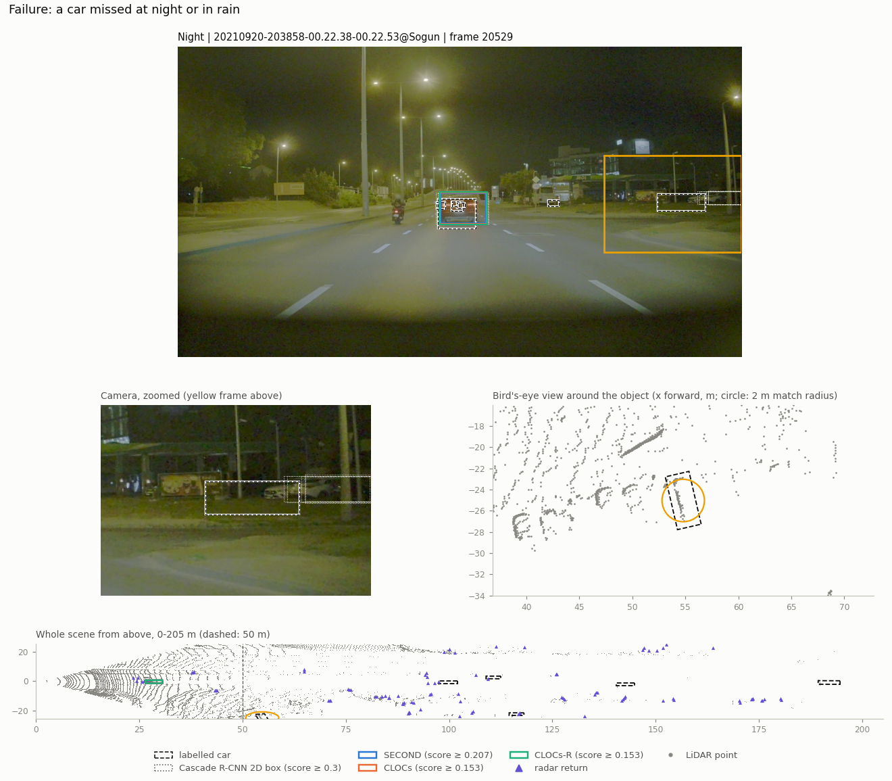

**Night**, scene `20210920-203858-00.22.38-00.22.53@Sogun`, frame 20529: car at 60 m. Best score within 2 m: SECOND none within 2 m; CLOCs 0.003 (below 0.153); CLOCs-R 0.003 (below 0.153). 79 LiDAR points in the box, 0 radar returns in the gate.

## How common each case is on val

Objects that meet each category's conditions, over all val frames, at the thresholds above:

| Category | Objects |
|---|---|
| Success: radar recovers a far car | 98 |
| Success: radar removes a far false alarm | 56 |
| Success: fusion recovers a car SECOND misses | 428 |
| Failure: fusion drops a far car SECOND found | 1,496 |
| Failure: a far car no model finds | 9,111 |
| Failure: radar adds a far false alarm | 47 |
| Failure: a car missed at night or in rain | 889 |
