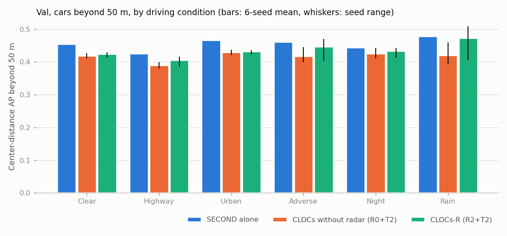
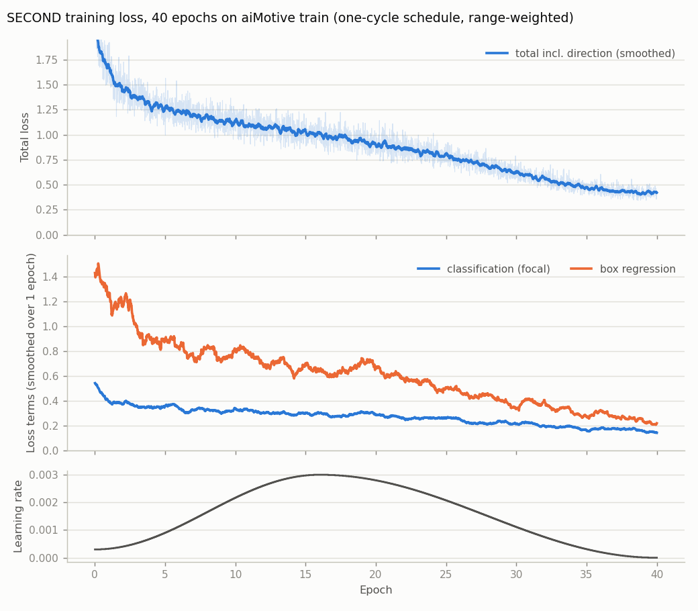
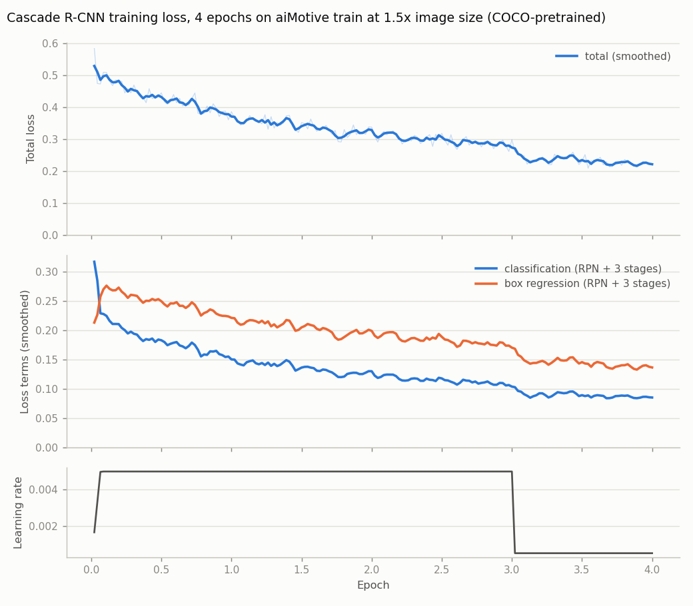
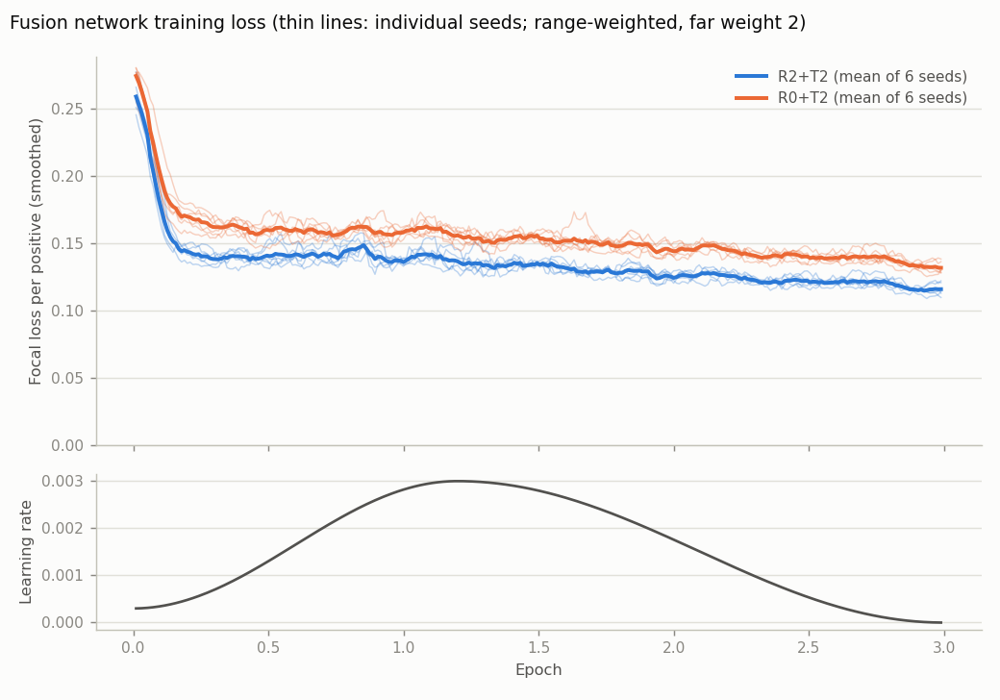

# CLOCs and CLOCs-R on the full aiMotive dataset

These runs used all four driving conditions (highway, urban, night, rain) and all 26,583 annotated frames. The detectors and the fusion network were trained with a loss weight that favours long range: x1 below 40 m, rising to x2 at 60 m and beyond.

The final configurations come from a full ablation of gate, feature sets and fusion changes, run on this data with selection on holdout only ([ablation/](ablation/README.md)):

| | Configuration | What it is |
|---|---|---|
| **CLOCs-R** | **R2+T2** | Doppler speed of the radar returns in each candidate's gate (δ0 = 0.5 m, κ = 0.02, 3 sweeps), fused logit = SECOND's logit + network output |
| **CLOCs** | **R0+T2** | The same network without radar |

The main metric is center-distance AP on cars beyond 50 m (16,372 on val). *Radar gain* is CLOCs-R minus CLOCs, seed against seed, given as the mean of **6 seed pairs** with the range. All tables are in [tables_final.md](tables_final.md), and the ablation's own tables are in [ablation/tables.md](ablation/tables.md).

| Document | Contents |
|---|---|
| [METHODS.md](METHODS.md) | What was run, in order, and every code change |
| [DATASET.md](DATASET.md) | The dataset, and how far cars are distributed across splits and conditions |
| [ablation/README.md](ablation/README.md) | The ablation that chose the final configurations |
| [EXAMPLES.md](EXAMPLES.md) | Val frames where the models succeed and fail |
| [PLAN.md](PLAN.md), [ablation/PLAN.md](ablation/PLAN.md) | The rules fixed before each round |



## Findings

- **Radar helps CLOCs at long range, but only a little except in rain.** On val beyond 50 m, CLOCs-R scores 0.422 against 0.414 for CLOCs. The gain is +0.008 (−0.003 to +0.025), positive in 5 of 6 seed pairs.

  | Condition | Radar gain beyond 50 m | Seed pairs > 0 |
  |---|---|---|
  | Rain | +0.052 (+0.002 to +0.115) | 6 of 6 |
  | Highway | +0.016 (−0.001 to +0.034) | 5 of 6 |
  | Night | +0.009 (−0.008 to +0.032) | 3 of 6 |
  | Urban | +0.002 (−0.004 to +0.013) | 3 of 6 |

  Rain is the only condition where every pair gains. Night and urban show no reliable gain.
- **The gain follows the radar evidence.** On highways and in rain, 81% of far cars have a radar return, and they move fast (rain scenes have a median speed of 112 km/h). In urban scenes only 51% have a return, and 40% of those are not moving, so Doppler says little about them ([DATASET.md](DATASET.md)).
- **The rain result could not come from selection.** Holdout has no rain cars beyond 50 m, so nothing in the ablation could favour rain.
- **SECOND alone still beats both fusion models beyond 50 m, in every condition.** Overall it scores 0.453, against 0.422 for CLOCs-R. In rain the gap shrinks to 0.006.
  - **Below 50 m, fusion wins:** 0.917 vs 0.901 at 0–30 m, and 0.671 vs 0.645 at 30–50 m.
  - **At long range the camera is the problem:** 98% of cars at 100–200 m are under 25 px tall, and Cascade R-CNN finds only 21% of them. CLOCs learns to doubt any 3D box without 2D support, so it suppresses real far cars.
  - **Recall at 100–200 m** (BEV IoU 0.3) is 0.660 for SECOND, 0.614 for CLOCs and 0.649 for CLOCs-R. Radar gives back part of what fusion takes away.
- **With the camera removed at test time, the fused models beat SECOND on val.** CLOCs-R without 2D candidates scores 0.461 beyond 50 m (SECOND 0.453), but holdout does not agree. See [ablation/README.md](ablation/README.md#camera-removed-at-test-time).
- **The fusion design matters more than the radar features.**
  - **Without the residual change (T2):** no radar feature set reliably beats the radar-free network, on either split.
  - **Richer features don't help:** support, Doppler spread, range residual, offset, RCS and longer motion-corrected sweep histories all fail to improve on Doppler speed alone.
  - **Far targets (T1) hurt clearly:** −0.039 on val.
- **The radar gate is not sensitive.** All 9 gates fall within 0.004 on holdout, which is less than the noise between seeds.
- **Range weighting in the fusion layer had no effect.** R0 scores 0.404 with far weight 2 and 0.405 with weight 1 (first round).

## Val, cars beyond 50 m, by condition (center-distance AP)

| Condition | Cars | SECOND | CLOCs R0+T2 | **CLOCs-R R2+T2** | Radar gain | Scenes where radar helps |
|---|---|---|---|---|---|---|
| All | 16,372 | 0.453 | 0.414 | **0.422** | +0.008 (−0.003 to +0.025) | 14 of 24 |
| Highway | 2,333 | 0.425 | 0.390 | **0.406** | +0.016 (−0.001 to +0.034) | 6 of 11 |
| Urban | 11,352 | 0.467 | 0.430 | **0.432** | +0.002 (−0.004 to +0.013) | 5 of 9 |
| Night | 1,349 | 0.445 | 0.425 | **0.434** | +0.009 (−0.008 to +0.032) | 1 of 2 |
| Rain | 1,338 | 0.479 | 0.421 | **0.473** | +0.052 (+0.002 to +0.115) | 2 of 2 |
| Adverse (night + rain) | 2,687 | 0.461 | 0.418 | **0.447** | +0.029 (−0.004 to +0.071) | 3 of 4 |

- **Scene counts:** only scenes with at least 50 cars beyond 50 m are counted. A scene "helped" if its mean gain over the 6 seed pairs is above zero.
- **Per-scene gains** are in [tables_final.md](tables_final.md#per-scene-val-center-distance-ap-beyond-50-m). The largest is +0.126, in a highway scene where CLOCs had suppressed many far cars (0.180 against 0.392 for SECOND).

### By distance, all conditions

| Distance | Cars | SECOND | CLOCs R0+T2 | CLOCs-R R2+T2 | Radar gain |
|---|---|---|---|---|---|
| 0–30 m | 3,111 | 0.901 | **0.918** | 0.917 | −0.001 |
| 30–50 m | 1,895 | 0.645 | 0.664 | **0.671** | +0.007 |
| 50–100 m | 8,148 | **0.612** | 0.574 | 0.577 | +0.002 |
| 100–200 m | 8,224 | **0.280** | 0.252 | 0.263 | +0.010 |

## Loss curves

All three trained parts converge smoothly, with no sign of divergence. Only training losses were logged, so these curves say nothing about overfitting (`plot_losses.py`).

- **SECOND:** 40 epochs, one-cycle schedule. The total and both loss terms are still falling at the end.

  
- **Cascade R-CNN:** 4 epochs, step decay after epoch 3.

  
- **Fusion:** the final pair, 6 seeds each, 3 epochs. CLOCs-R ends at a lower training loss than CLOCs (0.118 vs 0.131 at the last logged step, mean of 6 seeds). So the Doppler feature does carry information about which candidates are real, even though on val the gain is small outside rain and highway.

  

## Example frames

[EXAMPLES.md](EXAMPLES.md) shows 14 val frames in 7 categories, with camera, zoom, bird's-eye view and the whole scene. Each model runs at its F1-optimal threshold from holdout. Counts over all of val:

| Case | Objects |
|---|---|
| Success: radar recovers a far car that CLOCs misses | 98 |
| Success: radar removes a far false alarm that CLOCs keeps | 56 |
| Success: fusion recovers a car SECOND misses | 428 |
| Failure: fusion drops a far car SECOND found | 1,496 |
| Failure: radar adds a far false alarm | 47 |
| Failure: a far car no model finds | 9,111 |

The counts show three things:

- **Suppression outweighs recovery.** Fusion drops far cars that SECOND found (1,496) about 3.5 times as often as it finds cars SECOND missed (428).
- **Radar recoveries are rare and marginal.** There are 98 at a fixed threshold. In the examples, CLOCs-R's score clears its threshold by only 0.001.
- **Most far misses are shared:** no model finds them. These are typically cars at 100–200 m with only a handful of LiDAR points.

## Earlier rounds

1. **First round** (pre-registered in [PLAN.md](PLAN.md); [tables.md](tables.md)): 4 radar candidates and their twins, 3 seeds each, selected R2+T2 on holdout. Its 3-seed val gain was +0.011 overall and +0.071 in rain. The 6-seed estimates above are lower because seeds 4–6 gained less.
2. **R3+T2 rerun** (post hoc, outside the selection rule; [tables_r3.md](tables_r3.md)): support plus Doppler, 6 seeds. It gained +0.003 overall (−0.002 to +0.009) and +0.013 in rain, below R2+T2. In both rounds, adding the return count to Doppler did not help.
3. **Full ablation** ([ablation/](ablation/README.md)): re-derived the configurations from scratch on holdout, and arrived at R2+T2 and R0+T2 again.

## Caveats

- **Adverse conditions are thinly sampled.** Val has only 2 night and 2 rain scenes, about 1,340 far cars each. The rain gain holds in every seed pair and in both scenes, but it comes from two drives on one day.
- **Holdout cannot test far rain or far night.** It has no rain cars beyond 50 m and only 13 night cars at 100–200 m, so the selection is effectively tuned on clear conditions.
- **Seed ranges cover the fusion layer only.** The detectors were trained once, so their variance is not in the ranges.
- **Val had been read for the final pair before the ablation.** This happened in the first round. The ablation then re-derived the same pair from holdout alone.
- **No plain detectors were trained.** So the effect of range weighting on SECOND and Cascade R-CNN is not isolated.
- **AP3D does not separate the models** (about 0.16 beyond 50 m for all of them). The labels differ between aiMotive train and val, which caps strict 3D overlap ([`../detectors/README.md`](../detectors/README.md)).

## Reproduce

```bash
source env.sh
nohup setsid bash clocs_r/run_full.sh > runs/run_full.log 2>&1 &   # first round, after runs/second and runs/cascade are trained
python -m clocs_r.ablation_full                                       # full ablation, ~6 h, resumable
python results/full_dataset/ablation/make_tables.py
python results/full_dataset/per_scene.py --models R2+T2,R0+T2 --seeds 1,2,3,4,5,6 --weights runs/ablation/sets_d0.5_k0.02 --suffix _final
python results/full_dataset/make_report.py --model R2+T2 --twin R0+T2 --extra rerun_r2.json,rerun_r3.json --selected '' --suffix _final
python results/full_dataset/plot_losses.py
python results/full_dataset/examples.py
```

Weights:

- **SECOND:** `runs/second/checkpoint_epoch_40.pth`
- **Cascade R-CNN:** `runs/cascade/epoch_4.pth`
- **Final fusion networks:** `runs/ablation/sets_d0.5_k0.02/{R2+T2,R0+T2}_s{1..6}.pth`, with copies in git in [weights/](weights/README.md) (150 KB)

These weights come from aiMotive data and fall under its CC BY-NC-SA 4.0 license (non-commercial).
