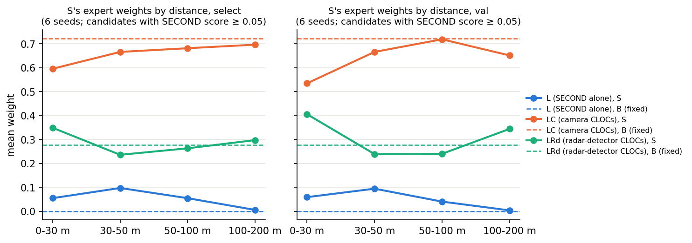

# Phase 7: radar through a detector, and a situational selector

Pre-registered in PLAN.md (Phase 7 and its addenda); decisions and interpretations in DECISIONS.md (2026-11-21). All numbers are APCD, means over 6 seeds (± seed SD), except SECOND alone.

| Label | Model |
|---|---|
| L | SECOND alone |
| L0 | R0+T2+NC: CLOCs without camera or radar (control) |
| LRf | R2+T2+NC: radar as point features, no camera |
| LRd | R0+T2+RP: radar through D2's boxes, no camera |
| LC | R0+T2+K40: camera CLOCs (Phase 3) |
| S | selector over L, LC, LRd |
| B | fixed blend of L, LC, LRd (post hoc) |
| inc | R2+T2+K40+G: incumbent before Phase 7 |

## 1. Radar detectors on their own (`select`, APCD)

| Detector | all | 0-30 | 30-50 | 50-100 | 100-200 | 50-200 |
|---|---|---|---|---|---|---|
| D1 (Phase 6 PointPillars) | 0.292 | 0.423 | 0.304 | 0.237 | 0.094 | 0.199 |
| D2 (motion-corrected, clutter probability) | 0.300 | 0.443 | 0.298 | 0.257 | 0.104 | 0.217 |
| D3 (RadarDistill, authors' code) | 0.300 | 0.433 | 0.338 | 0.265 | 0.077 | 0.215 |
| SECOND, for reference | 0.719 | 0.907 | 0.780 | 0.628 | 0.405 | 0.564 |

By the pre-registered rule, the radar detector with the highest 50–200 m APCD on `select` feeds RP: **D2**.
The radar detectors were not scored alone on val.

## 2. Models on `select` and val

### select

| Model | all | 0-30 | 30-50 | 50-100 | 100-200 | 50-200 |
|---|---|---|---|---|---|---|
| L | 0.7192 | 0.9072 | 0.7797 | 0.6277 | 0.4052 | 0.5639 |
| L0 | 0.7101 ± 0.0008 | 0.9071 ± 0.0004 | 0.7779 ± 0.0004 | 0.6266 ± 0.0004 | 0.4062 ± 0.0004 | 0.5605 ± 0.0004 |
| LRf | 0.7126 ± 0.0008 | 0.8995 ± 0.0010 | 0.7752 ± 0.0005 | 0.6384 ± 0.0014 | 0.4138 ± 0.0016 | 0.5729 ± 0.0012 |
| LRd | 0.7172 ± 0.0008 | 0.9080 ± 0.0003 | 0.7759 ± 0.0007 | 0.6431 ± 0.0012 | 0.4162 ± 0.0017 | 0.5753 ± 0.0010 |
| LC | 0.7250 ± 0.0007 | 0.9066 ± 0.0006 | 0.7864 ± 0.0015 | 0.6497 ± 0.0020 | 0.4096 ± 0.0033 | 0.5807 ± 0.0013 |
| S | 0.7343 ± 0.0006 | 0.9110 ± 0.0010 | 0.7931 ± 0.0009 | 0.6629 ± 0.0019 | 0.4184 ± 0.0021 | 0.5928 ± 0.0017 |
| B | 0.7342 ± 0.0004 | 0.9100 ± 0.0004 | 0.7921 ± 0.0008 | 0.6617 ± 0.0016 | 0.4261 ± 0.0011 | 0.5933 ± 0.0013 |
| inc | 0.7308 ± 0.0017 | 0.9074 ± 0.0010 | 0.7933 ± 0.0013 | 0.6575 ± 0.0032 | 0.4020 ± 0.0036 | 0.5856 ± 0.0034 |

### val

| Model | all | 0-30 | 30-50 | 50-100 | 100-200 | 50-200 |
|---|---|---|---|---|---|---|
| L | 0.5401 | 0.8971 | 0.6206 | 0.5992 | 0.2841 | 0.4455 |
| L0 | 0.5020 ± 0.0013 | 0.8959 ± 0.0004 | 0.6203 ± 0.0002 | 0.5979 ± 0.0002 | 0.2729 ± 0.0021 | 0.4282 ± 0.0012 |
| LRf | 0.4918 ± 0.0014 | 0.8672 ± 0.0029 | 0.6199 ± 0.0016 | 0.5866 ± 0.0007 | 0.2731 ± 0.0009 | 0.4233 ± 0.0011 |
| LRd | 0.5126 ± 0.0018 | 0.8913 ± 0.0006 | 0.6213 ± 0.0006 | 0.6028 ± 0.0004 | 0.2858 ± 0.0015 | 0.4415 ± 0.0020 |
| LC | 0.5247 ± 0.0019 | 0.9158 ± 0.0008 | 0.6304 ± 0.0010 | 0.5767 ± 0.0024 | 0.2789 ± 0.0038 | 0.4264 ± 0.0021 |
| S | 0.5339 ± 0.0042 | 0.9173 ± 0.0011 | 0.6404 ± 0.0010 | 0.5928 ± 0.0018 | 0.2877 ± 0.0022 | 0.4407 ± 0.0023 |
| B | 0.5376 ± 0.0016 | 0.9176 ± 0.0005 | 0.6398 ± 0.0017 | 0.5985 ± 0.0015 | 0.2912 ± 0.0021 | 0.4428 ± 0.0016 |
| inc | 0.5249 ± 0.0067 | 0.9141 ± 0.0011 | 0.6466 ± 0.0025 | 0.5809 ± 0.0038 | 0.2613 ± 0.0099 | 0.4199 ± 0.0055 |

### select, by condition (50–200 m / 100–200 m)

| Model | overall | clear | adverse | highway | urban | night | rain |
|---|---|---|---|---|---|---|---|
| L | 0.564 / 0.405 | 0.519 / 0.334 | 0.707 / 0.627 | 0.799 / 0.621 | 0.354 / 0.155 | 0.604 / 0.520 | 0.954 / 0.866 |
| L0 | 0.560 / 0.406 | 0.515 / 0.336 | 0.703 / 0.626 | 0.796 / 0.623 | 0.352 / 0.155 | 0.598 / 0.518 | 0.954 / 0.867 |
| LRf | 0.573 / 0.414 | 0.529 / 0.349 | 0.707 / 0.614 | 0.796 / 0.639 | 0.357 / 0.155 | 0.608 / 0.517 | 0.948 / 0.866 |
| LRd | 0.575 / 0.416 | 0.531 / 0.344 | 0.713 / 0.631 | 0.806 / 0.633 | 0.365 / 0.158 | 0.616 / 0.523 | 0.952 / 0.872 |
| LC | 0.581 / 0.410 | 0.533 / 0.333 | 0.722 / 0.629 | 0.792 / 0.589 | 0.371 / 0.164 | 0.616 / 0.524 | 0.968 / 0.912 |
| S | 0.593 / 0.418 | 0.544 / 0.340 | 0.737 / 0.644 | 0.806 / 0.612 | 0.380 / 0.162 | 0.635 / 0.529 | 0.971 / 0.922 |
| B | 0.593 / 0.426 | 0.544 / 0.348 | 0.740 / 0.653 | 0.809 / 0.624 | 0.380 / 0.167 | 0.639 / 0.535 | 0.974 / 0.930 |
| inc | 0.586 / 0.402 | 0.536 / 0.329 | 0.728 / 0.617 | 0.796 / 0.593 | 0.370 / 0.155 | 0.624 / 0.511 | 0.970 / 0.920 |

### val, by condition (50–200 m / 100–200 m)

| Model | overall | clear | adverse | highway | urban | night | rain |
|---|---|---|---|---|---|---|---|
| L | 0.446 / 0.284 | 0.441 / 0.265 | 0.483 / 0.390 | 0.434 / 0.263 | 0.448 / 0.273 | 0.428 / 0.434 | 0.549 / 0.345 |
| L0 | 0.428 / 0.273 | 0.423 / 0.254 | 0.465 / 0.380 | 0.403 / 0.242 | 0.432 / 0.264 | 0.416 / 0.427 | 0.527 / 0.333 |
| LRf | 0.423 / 0.273 | 0.419 / 0.255 | 0.467 / 0.382 | 0.403 / 0.236 | 0.427 / 0.270 | 0.421 / 0.422 | 0.523 / 0.341 |
| LRd | 0.442 / 0.286 | 0.435 / 0.266 | 0.486 / 0.397 | 0.425 / 0.257 | 0.440 / 0.276 | 0.436 / 0.440 | 0.549 / 0.354 |
| LC | 0.426 / 0.279 | 0.419 / 0.259 | 0.486 / 0.395 | 0.429 / 0.258 | 0.421 / 0.267 | 0.437 / 0.440 | 0.547 / 0.357 |
| S | 0.441 / 0.288 | 0.435 / 0.268 | 0.486 / 0.396 | 0.441 / 0.274 | 0.439 / 0.275 | 0.438 / 0.447 | 0.545 / 0.343 |
| B | 0.443 / 0.291 | 0.436 / 0.270 | 0.493 / 0.404 | 0.436 / 0.273 | 0.440 / 0.277 | 0.444 / 0.449 | 0.554 / 0.364 |
| inc | 0.420 / 0.261 | 0.414 / 0.244 | 0.470 / 0.364 | 0.418 / 0.243 | 0.415 / 0.251 | 0.433 / 0.427 | 0.516 / 0.304 |

## 3. Seed-paired differences (mean, and seeds where the first is higher)

L has no seeds, so differences against L are each seed against the one SECOND value.

| Comparison | select 0-30 | select 30-50 | select 50-200 | select 100-200 | val 0-30 | val 30-50 | val 50-200 | val 100-200 |
|---|---|---|---|---|---|---|---|---|
| LRd − L0 | +0.0009 (6/6) | -0.0020 (0/6) | +0.0148 (6/6) | +0.0100 (6/6) | -0.0046 (0/6) | +0.0010 (6/6) | +0.0133 (6/6) | +0.0129 (6/6) |
| LRf − L0 | -0.0076 (0/6) | -0.0027 (0/6) | +0.0124 (6/6) | +0.0076 (6/6) | -0.0286 (0/6) | -0.0003 (3/6) | -0.0049 (0/6) | +0.0003 (3/6) |
| LRd − LRf | +0.0084 (6/6) | +0.0008 (6/6) | +0.0024 (6/6) | +0.0024 (5/6) | +0.0240 (6/6) | +0.0013 (5/6) | +0.0182 (6/6) | +0.0126 (6/6) |
| LRd − L | +0.0008 (6/6) | -0.0038 (0/6) | +0.0114 (6/6) | +0.0110 (6/6) | -0.0058 (0/6) | +0.0007 (6/6) | -0.0040 (0/6) | +0.0016 (5/6) |
| LRf − L | -0.0077 (0/6) | -0.0046 (0/6) | +0.0090 (6/6) | +0.0087 (6/6) | -0.0298 (0/6) | -0.0007 (3/6) | -0.0222 (0/6) | -0.0110 (0/6) |
| S − LC | +0.0044 (6/6) | +0.0067 (6/6) | +0.0121 (6/6) | +0.0088 (6/6) | +0.0015 (4/6) | +0.0099 (6/6) | +0.0143 (6/6) | +0.0087 (6/6) |
| S − L | +0.0038 (6/6) | +0.0134 (6/6) | +0.0289 (6/6) | +0.0133 (6/6) | +0.0202 (6/6) | +0.0197 (6/6) | -0.0048 (0/6) | +0.0035 (6/6) |
| S − inc | +0.0036 (6/6) | -0.0002 (3/6) | +0.0072 (6/6) | +0.0164 (6/6) | +0.0032 (6/6) | -0.0062 (0/6) | +0.0207 (6/6) | +0.0264 (6/6) |
| S − B | +0.0010 (6/6) | +0.0010 (5/6) | -0.0005 (1/6) | -0.0077 (0/6) | -0.0003 (2/6) | +0.0006 (4/6) | -0.0022 (1/6) | -0.0035 (0/6) |
| B − LC | +0.0034 (6/6) | +0.0057 (6/6) | +0.0126 (6/6) | +0.0165 (6/6) | +0.0018 (6/6) | +0.0093 (6/6) | +0.0164 (6/6) | +0.0122 (6/6) |
| B − L | +0.0028 (6/6) | +0.0124 (6/6) | +0.0294 (6/6) | +0.0210 (6/6) | +0.0205 (6/6) | +0.0191 (6/6) | -0.0027 (0/6) | +0.0070 (6/6) |
| B − inc | +0.0026 (6/6) | -0.0012 (1/6) | +0.0077 (6/6) | +0.0241 (6/6) | +0.0035 (6/6) | -0.0068 (0/6) | +0.0229 (6/6) | +0.0299 (6/6) |
| LC − L | -0.0006 (1/6) | +0.0067 (6/6) | +0.0168 (6/6) | +0.0044 (6/6) | +0.0188 (6/6) | +0.0098 (6/6) | -0.0191 (0/6) | -0.0052 (0/6) |

## 4. The pre-registered rule (`select`)

A model replaces the incumbent only if its mean beats the incumbent's by more than its own seed SD at both 50–200 m and 100–200 m; among those, the highest 50–200 m mean wins.

| Candidate | 50–200 mean ± SD | incumbent | 100–200 mean ± SD | incumbent | beats |
|---|---|---|---|---|---|
| R2+T2+NC | 0.5729 ± 0.0012 | 0.5856 | 0.4138 ± 0.0016 | 0.4020 | no |
| R0+T2+RP | 0.5753 ± 0.0010 | 0.5856 | 0.4162 ± 0.0017 | 0.4020 | no |
| S(R0+T2+RP) | 0.5928 ± 0.0017 | 0.5856 | 0.4184 ± 0.0021 | 0.4020 | yes |
| R0+T2+NC | 0.5605 ± 0.0004 | 0.5856 | 0.4062 ± 0.0004 | 0.4020 | no |

Current model by the rule: **S(R0+T2+RP)**. B was defined after these results and is not a candidate.

## 5. Scene-bootstrap 95% intervals (1,000 scene resamples, means over 6 seeds)

### select (24 scenes, 3409 frames)

| Comparison | 50-100 | 100-200 | 50-200 | all |
|---|---|---|---|---|
| LRf - L0 | +0.0118 [-0.0036, +0.0274] | +0.0076 [-0.0065, +0.0208] | +0.0124 [-0.0018, +0.0262] | +0.0025 [-0.0047, +0.0100] |
| LRd - L0 | +0.0165 [+0.0071, +0.0252] | +0.0100 [+0.0017, +0.0170] | +0.0148 [+0.0070, +0.0218] | +0.0071 [+0.0023, +0.0114] |
| LRf - L | +0.0107 [-0.0050, +0.0258] | +0.0087 [-0.0056, +0.0217] | +0.0090 [-0.0053, +0.0224] | -0.0066 [-0.0168, +0.0027] |
| LRd - L | +0.0154 [+0.0058, +0.0241] | +0.0110 [+0.0032, +0.0174] | +0.0114 [+0.0032, +0.0185] | -0.0020 [-0.0103, +0.0050] |
| LRd - LRf | +0.0047 [-0.0058, +0.0155] | +0.0024 [-0.0103, +0.0135] | +0.0024 [-0.0078, +0.0128] | +0.0046 [-0.0007, +0.0096] |
| S - LC | +0.0132 [+0.0071, +0.0190] | +0.0088 [+0.0020, +0.0156] | +0.0121 [+0.0073, +0.0172] | +0.0093 [+0.0051, +0.0129] |
| S - L | +0.0352 [+0.0109, +0.0614] | +0.0133 [-0.0081, +0.0358] | +0.0289 [+0.0084, +0.0516] | +0.0151 [+0.0061, +0.0262] |
| S - inc | +0.0054 [-0.0007, +0.0110] | +0.0164 [+0.0032, +0.0340] | +0.0072 [+0.0010, +0.0133] | +0.0035 [+0.0011, +0.0056] |
| LC - L | +0.0220 [-0.0048, +0.0522] | +0.0045 [-0.0189, +0.0298] | +0.0168 [-0.0055, +0.0424] | +0.0058 [-0.0036, +0.0186] |
| S - B | +0.0012 [-0.0029, +0.0063] | -0.0077 [-0.0140, -0.0022] | -0.0005 [-0.0040, +0.0038] | +0.0001 [-0.0020, +0.0019] |
| B - LC | +0.0120 [+0.0024, +0.0207] | +0.0165 [+0.0076, +0.0260] | +0.0126 [+0.0043, +0.0204] | +0.0092 [+0.0051, +0.0131] |
| B - L | +0.0340 [+0.0134, +0.0564] | +0.0210 [+0.0014, +0.0410] | +0.0294 [+0.0121, +0.0480] | +0.0150 [+0.0069, +0.0254] |
| B - inc | +0.0042 [-0.0064, +0.0133] | +0.0241 [+0.0094, +0.0425] | +0.0077 [-0.0028, +0.0168] | +0.0034 [+0.0003, +0.0061] |

### val (25 scenes, 5181 frames)

| Comparison | 50-100 | 100-200 | 50-200 | all |
|---|---|---|---|---|
| LRf - L0 | -0.0113 [-0.0217, +0.0037] | +0.0003 [-0.0065, +0.0060] | -0.0049 [-0.0128, +0.0039] | -0.0102 [-0.0185, -0.0012] |
| LRd - L0 | +0.0049 [-0.0088, +0.0206] | +0.0129 [+0.0078, +0.0179] | +0.0133 [+0.0049, +0.0228] | +0.0106 [+0.0029, +0.0190] |
| LRf - L | -0.0126 [-0.0230, +0.0021] | -0.0110 [-0.0193, -0.0034] | -0.0222 [-0.0300, -0.0137] | -0.0483 [-0.0602, -0.0357] |
| LRd - L | +0.0036 [-0.0106, +0.0189] | +0.0016 [-0.0042, +0.0079] | -0.0040 [-0.0146, +0.0050] | -0.0275 [-0.0393, -0.0176] |
| LRd - LRf | +0.0162 [+0.0017, +0.0248] | +0.0126 [+0.0068, +0.0191] | +0.0182 [+0.0104, +0.0238] | +0.0208 [+0.0115, +0.0278] |
| S - LC | +0.0160 [+0.0085, +0.0211] | +0.0087 [+0.0008, +0.0181] | +0.0143 [+0.0084, +0.0196] | +0.0092 [+0.0011, +0.0175] |
| S - L | -0.0065 [-0.0176, +0.0019] | +0.0035 [-0.0075, +0.0156] | -0.0048 [-0.0139, +0.0038] | -0.0061 [-0.0124, +0.0012] |
| S - inc | +0.0119 [+0.0019, +0.0190] | +0.0264 [+0.0119, +0.0422] | +0.0207 [+0.0132, +0.0291] | +0.0091 [+0.0035, +0.0162] |
| LC - L | -0.0225 [-0.0366, -0.0092] | -0.0052 [-0.0231, +0.0135] | -0.0191 [-0.0312, -0.0071] | -0.0154 [-0.0272, -0.0039] |
| S - B | -0.0058 [-0.0099, -0.0021] | -0.0035 [-0.0076, +0.0015] | -0.0022 [-0.0052, +0.0018] | -0.0037 [-0.0085, +0.0011] |
| B - LC | +0.0218 [+0.0149, +0.0270] | +0.0122 [+0.0055, +0.0189] | +0.0164 [+0.0115, +0.0200] | +0.0130 [+0.0079, +0.0171] |
| B - L | -0.0007 [-0.0118, +0.0079] | +0.0070 [-0.0057, +0.0199] | -0.0027 [-0.0130, +0.0057] | -0.0024 [-0.0109, +0.0052] |
| B - inc | +0.0177 [+0.0086, +0.0253] | +0.0299 [+0.0165, +0.0421] | +0.0229 [+0.0152, +0.0299] | +0.0128 [+0.0084, +0.0179] |

## 6. Expert weights

Mean weights of candidates with SECOND score ≥ 0.05, by condition and distance (L, LC, LRd).

### S on select

| Condition, bin | L | LC | LRd | candidates |
|---|---|---|---|---|
| highway|0-30 | 0.024 | 0.572 | 0.404 | 6515 |
| highway|30-50 | 0.045 | 0.629 | 0.326 | 14360 |
| highway|50-100 | 0.025 | 0.719 | 0.256 | 21938 |
| highway|100-200 | 0.004 | 0.716 | 0.280 | 11562 |
| night|0-30 | 0.040 | 0.569 | 0.391 | 5019 |
| night|30-50 | 0.105 | 0.682 | 0.213 | 11001 |
| night|50-100 | 0.060 | 0.651 | 0.289 | 22763 |
| night|100-200 | 0.003 | 0.710 | 0.287 | 3999 |
| rain|0-30 | 0.008 | 0.515 | 0.477 | 270 |
| rain|30-50 | 0.030 | 0.747 | 0.223 | 1453 |
| rain|50-100 | 0.031 | 0.756 | 0.214 | 4057 |
| rain|100-200 | 0.008 | 0.817 | 0.175 | 4208 |
| urban|0-30 | 0.068 | 0.610 | 0.322 | 22247 |
| urban|30-50 | 0.114 | 0.672 | 0.214 | 46588 |
| urban|50-100 | 0.062 | 0.677 | 0.261 | 86238 |
| urban|100-200 | 0.007 | 0.649 | 0.343 | 16671 |

### S on val

| Condition, bin | L | LC | LRd | candidates |
|---|---|---|---|---|
| highway|0-30 | 0.019 | 0.487 | 0.495 | 2703 |
| highway|30-50 | 0.068 | 0.644 | 0.288 | 6002 |
| highway|50-100 | 0.032 | 0.671 | 0.297 | 12995 |
| highway|100-200 | 0.004 | 0.613 | 0.383 | 9122 |
| night|0-30 | 0.011 | 0.501 | 0.488 | 3249 |
| night|30-50 | 0.029 | 0.643 | 0.328 | 2608 |
| night|50-100 | 0.019 | 0.710 | 0.271 | 6308 |
| night|100-200 | 0.004 | 0.671 | 0.325 | 5119 |
| rain|0-30 | 0.050 | 0.653 | 0.298 | 2987 |
| rain|30-50 | 0.050 | 0.621 | 0.329 | 3417 |
| rain|50-100 | 0.014 | 0.670 | 0.316 | 11480 |
| rain|100-200 | 0.001 | 0.602 | 0.397 | 5429 |
| urban|0-30 | 0.074 | 0.529 | 0.397 | 19806 |
| urban|30-50 | 0.122 | 0.686 | 0.193 | 17953 |
| urban|50-100 | 0.047 | 0.734 | 0.219 | 84943 |
| urban|100-200 | 0.005 | 0.674 | 0.322 | 23256 |

### B (the same for every candidate)

| Seed | L | LC | LRd |
|---|---|---|---|
| 1 | 0.000 | 0.717 | 0.283 |
| 2 | 0.000 | 0.722 | 0.278 |
| 3 | 0.000 | 0.723 | 0.277 |
| 4 | 0.000 | 0.718 | 0.282 |
| 5 | 0.000 | 0.740 | 0.260 |
| 6 | 0.000 | 0.718 | 0.282 |
| mean | 0.000 | 0.723 | 0.277 |



## 7. Oracle ceiling of situation-dependent blends (`select`; upper bounds tuned on `select`)

231 weightings on the simplex (step 0.05), 6 seeds. Each oracle minus B:

| Upper bound | 0-30 | 30-50 | 50-100 | 100-200 | 50-200 |
|---|---|---|---|---|---|
| best single w per bin | +0.0017 | +0.0003 | +0.0009 | +0.0023 | +0.0009 |
| best w per distance bin | +0.0010 | -0.0003 | +0.0008 | +0.0025 | +0.0015 |
| best w per distance bin and condition (annotation labels) | -0.0044 | +0.0014 | +0.0017 | +0.0043 | +0.0030 |
| distance oracle − global oracle | -0.0007 | -0.0006 | -0.0001 | +0.0002 | +0.0006 |

Rule: further selector variants only if the distance oracle beats B by ≥ 0.005 at 100–200 m. It is +0.0025, so **selector work stops**.

## 8. Every variant tried in Phase 7

- **Radar input** for the radar detector, chosen on `select` by the rule: D2's inputs (motion-corrected sweeps and the
  clutter probability) over D1's.
- **Radar detectors:** D1, D2 and D3 (RadarDistill: teacher 10 epochs, student 20, halved by the pre-registered
  24-hour rule). D2 chosen.
- **Radar experts:** LRf (R2+T2+NC) and LRd (R0+T2+RP), each 6 seeds, against the control L0 (R0+T2+NC). LRd chosen as
  S's radar expert by the rule.
- **Selector S** over L, LC, LRd: 6 seeds, out-of-fold stacking on `fit`'s 3 scene folds.
- **Post hoc, labelled as such:**
  - the fixed blend B, 6 seeds, defined after the `select` results;
  - the oracle ceiling (diagnostic, upper bounds on `select` only, never on val).
- **Considered and not run:**
  - after the ceiling, by its rule: S plus radar-detector evidence, and a selector over the three detectors' own scores;
  - by the user's decision: a per-distance calibration of the fused score (DECISIONS.md, 2026-11-21, item 9).

## 9. Val exposure

- Val was looked at in every earlier phase, so it is a development set (REEVALUATION.md, section 5).
- **In Phase 7, val was scored once,** on 2026-11-21 (`phase7_val.sh`, 12:50–18:58 UTC), after every model and B
  were frozen. It was scored for L0, LRf, LRd, S and B from saved weights, plus the scene bootstrap. LC, the incumbent
  and SECOND are earlier models whose val results were already known.
- No setting was changed after val was seen. The ceiling check ran after val, on `select` only, as a diagnostic.

## Reproduce

```bash
bash results/next_round/phase7_run.sh      # radar detectors, experts, selector, the rule (select only)
bash results/next_round/phase7_val.sh      # B on select, val once for every model, scene bootstrap
python -W ignore -m clocs_r.selector_ceiling --radar_dets runs/next_round/phase7/d2_dets --out results/next_round/phase7/ceiling.json
python results/next_round/phase7_report.py > results/next_round/phase7/report.md
```
